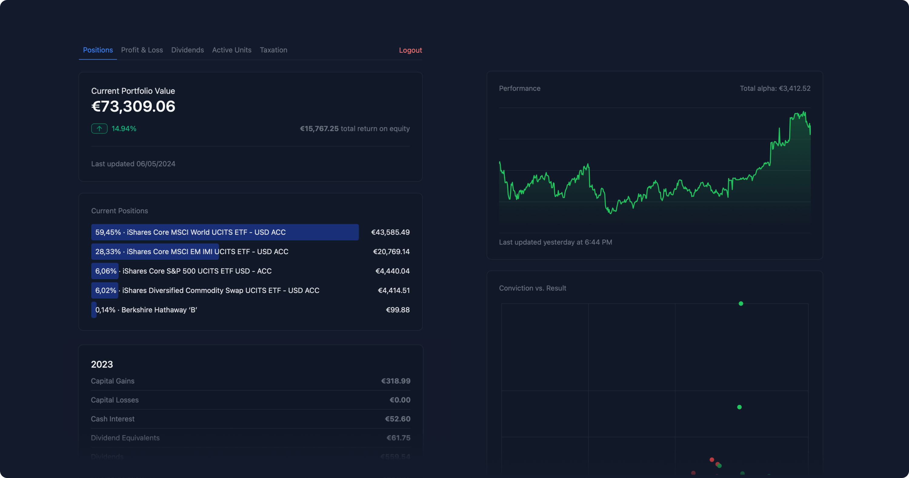

# Doughbox

## What is this?

Doughbox is a self-hosted portfolio tracker. It lets you import various brokerage statements (more on supported brokers below), stores them all in a unified format in a Postgres instance and then displays various stats on your portfolio, either via CLI or web interface (which can also be used as PWA on your phone).

If you need to take care of capital gains taxes in Austria, you can use Doughbox to help you prepare your tax declaration. Beware that I'm not a tax advisor and I take no responsibility for the outcome — you're responsible for your taxes, so: read the code, do your own research and consult a professional tax advisor.



## Features

- Self-hosted, with a Docker image for easy deployment.
- Web interface, CLI and API.
- Support for FX conversions and trades in non-Euro currencies with FX rates from the ECB.
- Optional automatic EUR equity/ETF prices from Xetra, Tradegate, Frankfurt, Cboe Europe and Euronext, using a durable Postgres queue with scheduling and worker limits managed in the web UI.
- Import brokerage statements from various brokers, e.g. Trade Republic, Revolut, Trading 212, etc.
- Display Portfolio Allocation across brokerage accounts.
- Display returns over time for the portfolio and individual positions (both open and closed).
- Display a consolidated timeline across brokers of past trades, interest & dividend payments and fx conversions.
- Go back in time and view your past portfolio's holdings.
- With a FRED token, compare securities P&L including recorded dividends against a nominal S&P 500 price-index proxy using the same gross purchase budget and sold units; the benchmark has no simulated fees, taxes, currency returns or dividend reinvestment.
- Fetches stock split data from polygon.io (hence, you will need an API token from Polygon).
- (Naive, optional) password authentication for login to the web interface. Multi-user support is not planned for now.
- Each transaction is assigned an ID either based on the ID from the broker or, if that isn't available, a combination of transaction characteristics. Thus, reimporting the same brokerage statement will not cause duplicate entries.
- Austrian tax preparation with fee-exclusive moving-average EUR security costs per broker/ISIN, separate gross income and estimated withholding credits.
- Set `TG_TOKEN` and `TG_CHAT_ID` to receive daily Telegram portfolio summaries on a schedule configured in **Settings**, or send one manually with `portfolio -n`.

## (Known) Limitations

- EUR as base currency — it supports trades in other currencies, but the base currency needs to be EUR.
- Automatic prices are opt-in and currently cover EUR monetary quotations for instruments imported as `Equity` (including ETFs). Bonds, derivatives and non-EUR market quotations are not automatically priced. Coverage depends on eligible post-trade reports on the enabled venues, including zero-volume price indications; these are delayed valuations, not guaranteed executed-trade prices, live quotes or official closing prices.
- Doughbox uses ISINs as primary identifier, so it's agnostic to the trading venue an instrument was bought. If it encounters a ticker symbol during the import, it attempts to convert it to an ISIN via the OpenFIGI API
- Crypto isn't supported.
- Custom physical gold, real estate, private loans, and interest-bearing cash accounts can be tracked manually in the web UI. They aren't considered for Taxation.
- Precomputed performance and taxation need to be refreshed explicitly from the web client or the CLI.
- Tax reports are preparation aids, not final Austrian tax payable. Read their `limitations`: complete acquisition history, depot identity, cash FX, income classification, fund-report coverage, treaty eligibility and annual loss offsets need review.
- Trade execution assumes an EUR base account; commission currency is handled separately.

## Supported brokers

| Broker               | Equities & ETFs | Bonds         | Derivatives   | Interest      | FX conversions |
| -------------------- | --------------- | ------------- | ------------- | ------------- | -------------- |
| Revolut              | ✅              | ⚠️ Might work | n.a.          | ⚠️ Might work | ✅             |
| Trade Republic       | ✅              | ✅            | ✅            | ✅            | n.a.           |
| Scalable             | ✅              | n.a.          | ⚠️ Might work | ❌            | n.a.           |
| Erste Bank / George  | ✅              | ⚠️ Might work | ⚠️ Might work | n.a.          | ❌             |
| Wise                 | n.a.            | n.a.          | n.a.          | ✅            | ✅             |
| Interactive Brokers  | ✅              | ✅            | ✅            | n.a.          | ✅             |
| Lightyear            | ✅              | n.a.          | n.a.          | ✅            | ✅             |
| Trading 212 (Invest) | ✅              | n.a.          | n.a.          | ✅            | ✅             |

## Supported price feeds

| Exchange / feed | Coverage                                                                                                   | Feed key             |
| --------------- | ---------------------------------------------------------------------------------------------------------- | -------------------- |
| Xetra           | Deutsche Börse delayed post-trade reports                                                                  | `DETR-posttrade`     |
| Tradegate       | Deutsche Börse delayed post-trade reports                                                                  | `DGAT-posttrade`     |
| Frankfurt       | Deutsche Börse delayed post-trade reports                                                                  | `DFRA-posttrade`     |
| Cboe Europe     | BXE, CXE and DXE exchange streams; APA/TRF reporting excluded                                              | `CBOE-posttrade`     |
| Euronext        | Equities and ETFs/funds across Amsterdam, Brussels, Dublin, Lisbon, Milan, Oslo and Paris, where available | `EURONEXT-posttrade` |

All feeds use eligible EUR monetary reports for known equity/ETF ISINs. Select exchanges in **Data → Price Feeds → Manage scheduler**; refresh and reset controls are available per exchange. These are delayed valuations, not live quotes or guaranteed closing prices.

## Why does this exist?

Doughbox is scratching my own itch: I have lots of different brokerage accounts and I wanted an easy way to stay on top of my portfolio allocation and its performance. While there are great portfolio tracking apps out there (Delta, Finanzfluss Co-Pilot, Parqet, Quin), I wanted to have full control over the data and the supported brokers. And when the need for some custom visulations and capital gains tax preparation came about, I started developing Doughbox. Since I use a lot of open source, self-hosted services, it makes sense for me to open source my personal infrastructure, too.

## Get Started

In order for Doughbox to run, you need a running Postgres instance. A polygon.io API key is needed for stock-split housekeeping, but not for the API or price refreshes.

### Environment variables

| Variable                  | Required         | Purpose                                                                        |
| ------------------------- | ---------------- | ------------------------------------------------------------------------------ |
| `POSTGRES_URL`            | yes              | Postgres connection string                                                     |
| `POLYGON_TOKEN`           | for stock splits | Stock-split data from polygon.io                                               |
| `FRED_TOKEN`              | no               | S&P 500 benchmark via FRED                                                     |
| `PASSWORD`                | no               | Web UI login password                                                          |
| `API_TOKEN`               | no               | Bearer token for the HTTP API                                                  |
| `TG_TOKEN` / `TG_CHAT_ID` | no               | Scheduled Telegram portfolio reports and manual notifications (`portfolio -n`) |
| `RUST_ENV`                | no               | Loads `.env.dev` when `development` (default), `.env.prod` when `production`   |

The **Settings** page shows whether `TG_TOKEN` and `TG_CHAT_ID` are set on the server. Set values use the same green check-circle badges as successful imports; missing, empty, or whitespace-only values use a muted **Not set** badge. This read-only status never exposes the values and does not validate them with Telegram.

### Docker

```bash
  docker run -d \
  -e POSTGRES_URL="your_postgres_url_here" \
  -e POLYGON_TOKEN="your_polygon_token_here" \
  -p 8084:8084 \
  -v /path/to/your/input-directory:/app/input \
  -v /path/to/your/output-directory:/app/output \
  ghcr.io/alxjpzmn/doughbox:latest
```

Once the app runs, the Web UI will be available. Interactive API docs are at `/api/docs` (OpenAPI spec at `/api/openapi.json`). If you've also set `API_TOKEN`, you can call the API with `Authorization: Bearer $API_TOKEN`.

First, import your brokerage statements (PDF or CSV, depending on the broker) using **Portfolio → Timeline → Import**. Drop multiple files into the upload area or use **Choose files**, then select **Upload and queue**. Alternatively, place the statements in a folder and run `./doughbox import foldername`.

If you run Dougbox inside Docker, the directory path needs to correspond to to the path inside the container, so `./input`. The full command for importing then becomes: `docker container exec -i doughbox ./doughbox import ./input`. The first import will likely be a bit slower than subsequent ones, since Doughbox will fetch historic FX rates.

After the first import, you will be prompted to run housekeeping and some portfolio and PL calculations, unless you called the import command with `--silent`. Especially on the first run it's highly recommended to run at least `housekeeping` (which will e.g. fetch data on past stock splits based on your holdings).

The web interface will be available per default on port `8084`.

You can run the following commands in the CLI:

`housekeeping`: for fetching stock split data, tax data for funds and ETFs from the Austrian Control Bank (OeKB) and updated FX rates from the ECB.

`portfolio`: to show your current holdings and their allocation in the terminal. Pass `-n` / `--notify` to also send the summary via Telegram.

`performance`: calculates and exports returns for present and past securities, with an S&P 500 price-index comparison when a FRED token is configured. Saved results are displayed in the web interface. The web **Refresh performance** button also saves a fresh whole-portfolio history snapshot.

`taxation`: calculates realized gains and losses, dividends, interest, OeKB dividend equivalents and recorded withholding using perpetual WAC. It saves a reusable report/transaction bundle for the web interface. Optional flags: `--from YYYY-MM-DD`, `--until YYYY-MM-DD`, `--with-events` (per-transaction breakdown).

`debug-pdf <path>`: print extracted text from a PDF statement (useful when adding or debugging an importer).

`api`: the command to run the web server that serves both the web frontend and the API. The docker container automatically runs this.

`prices refresh [--feed xetra|tradegate|frankfurt|cboe|euronext] [--dry-run]`: enqueue the persisted feed selection (or one explicitly named feed) and wait for completion, or validate the available last 48 hours without writing prices/checkpoints/jobs. Shows queue status and refresh progress; does not prompt for FX updates. With no selected feeds, choose a feed explicitly or update the UI selection.

`prices status`: JSON summary of the schedule, queue and current holdings' price sources/timestamps.

`prices worker`: run queue consumers for all supported feeds without the HTTP server or scheduler. Useful for a separate worker container; automatic scheduling requires an `api` process and the persisted scheduler enabled. Each process applies the worker limit saved in the web UI.

`prices set <ISIN> --price 123.45 [--as-of 2026-10-15T12:00:00Z]`: pin a positive manual **EUR per-unit** price. `prices unpin <ISIN>` removes the override and reselects stored market data or an execution fallback.

### Telegram portfolio reports

Open **Settings → Telegram notifications** to enable **Daily portfolio reports**, choose the **Daily send time (UTC)**, and **Save report schedule**. The schedule starts paused with **18:00 UTC** preselected. It persists across restarts and applies without restarting; the API must be running, but the browser need not be open.

### Brokerage statement imports

Open **Portfolio → Timeline** and tap **Import** to import brokerage transactions for supported brokers. Drag one or more PDF/CSV files into the drop area, or use **Choose files**, then select **Upload and queue**. The drop area highlights while files are dragged over it. **Hide imports** collapses the section without clearing selected files or stopping queue updates. Brokers are detected automatically. Uploads accept up to 100 non-empty files per batch, 25 MiB per file, and 99 MiB combined; the API allows a 100 MiB multipart body including headers. Invalid uploads reject the entire batch before enqueueing any file. Keep the page open until upload confirmation; afterwards the API processes the files without the browser.

API clients can use `POST /api/statement-imports` with repeated multipart fields named `files`, then poll `GET /api/statement-imports`. Both return `{"jobs":[...]}`; POST returns `202` after the whole batch is persisted. Job IDs are strings; each job includes its filename, byte size, status, queued/started/finished timestamps, and error when failed.

```bash
curl -H "Authorization: Bearer $API_TOKEN" \
  -F 'files=@statement.csv' -F 'files=@statement.pdf' \
  http://localhost:8084/api/statement-imports
```

### REST API

The API provides portfolio/tax reads, custom-asset management, instrument name/manual-price management, scheduler/import controls, and non-sensitive application settings. Browser sessions from `POST /api/login` and `Authorization: Bearer $API_TOKEN` are both accepted; all writes use the same authentication.

Sessions are stored in memory and are lost when the API restarts; separate API replicas do not share session records. A browser retaining an old cookie can then produce `record not found in store` warnings and must sign in again. These session lookups are independent of price-worker jobs.

| Method               | Path                                                          | Purpose                                                                                                                                                               |
| -------------------- | ------------------------------------------------------------- | --------------------------------------------------------------------------------------------------------------------------------------------------------------------- |
| `GET`                | `/api/docs`                                                   | Interactive Swagger UI (no auth)                                                                                                                                      |
| `GET`                | `/api/openapi.json`                                           | OpenAPI spec                                                                                                                                                          |
| `GET`                | `/api/portfolio`                                              | Allocations and total return                                                                                                                                          |
| `GET`                | `/api/positions?date=&isin=&broker=`                          | Holdings as of a date                                                                                                                                                 |
| `GET`                | `/api/trades?isin=&broker=&direction=&from_date=&until_date=` | Trades                                                                                                                                                                |
| `GET`                | `/api/buy-ins?isin=&broker=`                                  | Economic WAC per instrument/broker; `422 IncompleteSecurityHistory` when recorded acquisitions cannot cover a sale                                                    |
| `GET`                | `/api/performance?isin=&broker=`                              | Live performance without file writes; `422 IncompleteSecurityHistory` rather than a fabricated cost basis                                                             |
| `GET`                | `/api/performance_overview`                                   | Precomputed `output/performance.json`                                                                                                                                 |
| `GET`                | `/api/past_performance`                                       | Historical value snapshots                                                                                                                                            |
| `GET`                | `/api/performance/status`                                     | Persisted manual calculation status, timestamps and last error                                                                                                        |
| `POST`               | `/api/performance/refresh`                                    | Rebuild performance exports and save a history snapshot in the background; returns `202`, coalescing an already-running request                                       |
| `GET`                | `/api/timeline?start_date=&isin=&broker=&event_type=`         | Unified event timeline                                                                                                                                                |
| `GET`                | `/api/timeline/investment-activity?start_date=`               | Monthly net purchases, net cash added, and dividends & interest (EUR), optionally filtered from an inclusive UTC start date                                           |
| `GET`                | `/api/statement-imports`                                      | All active and latest 100 completed statement uploads with per-file timestamps and errors; newest ID first                                                            |
| `POST`               | `/api/statement-imports`                                      | Atomically queue repeated multipart `files` fields (PDF/CSV); returns `202` with accepted jobs; 100 files, 25 MiB each, 100 MiB total request                         |
| `GET`                | `/api/instruments` / `/api/instruments/{isin}`                | All known instruments with safe `quote` valuation/provenance metadata; existing top-level fields remain available                                                     |
| `PATCH`              | `/api/instruments/{isin}`                                     | Rename an existing instrument with `{"name":"Display name"}`; trims/rejects blank names without changing prices                                                       |
| `PUT`                | `/api/instruments/{isin}/price`                               | Pin a positive manual EUR unit price, e.g. `{"price":"123.456789","as_of":"2026-10-18T12:00:00Z"}`; `as_of` is optional and cannot be in the future                   |
| `DELETE`             | `/api/instruments/{isin}/price`                               | Remove the manual pin and reselect stored market data or fallback                                                                                                     |
| `GET`                | `/api/prices`                                                 | Price schedule, queue errors and current holdings' quote provenance (no upstream requests)                                                                            |
| `PUT`                | `/api/prices/scheduler`                                       | Persist `{"enabled":true,"interval_minutes":30,"worker_concurrency":2,"feeds":["DETR-posttrade","DFRA-posttrade"]}`; apply without restart                            |
| `POST`               | `/api/prices/refresh`                                         | Queue the selected feeds, even while automatic scheduling is paused; returns `202` with current status                                                                |
| `POST`               | `/api/prices/feeds/{feed}/refresh`                            | Queue one supported feed; preserves active work and retry backoff                                                                                                     |
| `POST`               | `/api/prices/feeds/{feed}/reset`                              | Retire a queued/running job and queue a fresh attempt; preserve completed checkpoints, reports, prices, pins and history                                              |
| `GET`                | `/api/data-imports`                                           | Polygon/ECB availability, persisted per-source schedules, next runs, import status, timestamps, errors, stored counts and latest dates                                |
| `POST`               | `/api/data-imports/{source}/refresh`                          | Start `polygon` or `ecb` in the background; returns `202` with status, or `503` when the Polygon token is missing                                                     |
| `PUT`                | `/api/data-imports/{source}/scheduler`                        | Persist `{"enabled":true,"frequency":"monthly"}` for `polygon` or `ecb`; frequencies: `daily`, `weekly`, `monthly`; returns all source statuses                       |
| `GET` / `PUT`        | `/api/settings`                                               | Read/save non-sensitive preferences, e.g. `{"log_level":"DEBUG"}`; responses include read-only `telegram_token_set` / `telegram_chat_id_set` flags, never credentials |
| `PUT`                | `/api/settings/telegram-scheduler`                            | Save daily Telegram reports with `{"enabled":true,"send_time_utc":"18:00"}` (strict 24-hour UTC); returns settings including persisted `telegram_schedule` status     |
| `GET`                | `/api/brokers`                                                | Distinct broker names (use these as filter values)                                                                                                                    |
| `GET`                | `/api/dividends` / `/api/interest` / `/api/fx-conversions`    | Cash events                                                                                                                                                           |
| `GET`                | `/api/taxation?from_date=&until_date=`                        | Saved summary for the exact inclusive UTC date range; `404` if not calculated                                                                                         |
| `GET`                | `/api/taxation/transactions?from_date=&until_date=`           | Saved transaction impacts from the same calculation; never replays events                                                                                             |
| `GET`                | `/api/taxation/detailed?from_date=&until_date=`               | Saved report and transaction bundle for download; never recalculates                                                                                                  |
| `GET`                | `/api/taxation/status`                                        | Persisted manual calculation status, timestamps, last error and actual requested range                                                                                |
| `POST`               | `/api/taxation/refresh?from_date=&until_date=`                | Calculate and save the selected range in the background; returns `202`, coalescing an already-running request                                                         |
| `GET`/`POST`         | `/api/assets`                                                 | List or create custom assets (`?include_archived=true` to include archived)                                                                                           |
| `GET`/`PUT`/`DELETE` | `/api/assets/{asset_id}`                                      | Custom asset detail, update, and archive                                                                                                                              |
| `POST`               | `/api/assets/{asset_id}/restore`                              | Restore an archived custom asset                                                                                                                                      |
| `GET`                | `/api/assets/holdings`                                        | Custom holdings and EUR values                                                                                                                                        |
| `GET`                | `/api/cash-accounts/summary`                                  | Volume-weighted cash interest                                                                                                                                         |

Portfolio responses combine securities and custom holdings. Missing security quotes have `value: null` and `share: null`, set `valuation_complete: false`, and are listed in `unpriced_isins`; aggregate returns must not be used in that state. Custom holdings with missing valuation or cost data set `returns_incomplete: true` and increment `unpriced_assets`; only known returns are included. The portfolio summary shows these conditions separately. CLI reporting and web performance refresh refuse to save a history snapshot when either condition is present.

Incomplete security acquisition history is reported separately in `security_history_gaps`: broker, canonical ISIN, first uncovered sale date, recorded inventory and sold quantity (split-adjusted shares). The portfolio remains available with `returns_incomplete: true` and **Known P&L**. Trading P&L for each affected canonical ISIN is excluded across all brokers; recorded dividends and gross purchases remain included. Holdings themselves may be incomplete, so reconcile quantities against broker statements and do not use the aggregate percentage while returns are incomplete.

Live performance and buy-ins return `422 IncompleteSecurityHistory` until the history is reconciled. Performance refresh reports the specific gap and refuses to overwrite exports or save a snapshot; taxation also remains strict about missing acquisition history. Active-only widgets are hidden because the active holding set cannot be determined reliably; saved full-portfolio results remain available. Verify the recorded sale quantity and import or reconcile the original acquisitions or transferred cost basis—never substitute a zero-cost purchase or ignore an oversale.

### Manual web calculations

- **Performance → Refresh performance** rebuilds the CSV/JSON securities exports and saves an income-inclusive, filterable portfolio history point. The saved widgets refresh when the job completes; leaving the page does not cancel the job.
- **Taxation → Recalculate taxation** saves the summary, transaction impacts and detailed export from one historical replay for the selected inclusive date range. Opening the page, switching tabs, changing dates and pressing **Export Detailed** only read saved results. An uncached range prompts an explicit calculation instead of calculating automatically.
- Full-history taxation is saved as `output/taxation_detailed.json` plus the summary `output/taxation.json`. Selected ranges use `output/taxation_detailed_from_<YYYY-MM-DD|all>_until_<YYYY-MM-DD|all>.json` and never overwrite full-history results. The summary, transactions and detailed GET endpoints all read the matching bundle; legacy summary-only or mismatched-range exports need one explicit recalculation.
- CSV/JSON files are published individually by atomic rename, so readers do not receive partially written files. A failed job preserves its previous last-success timestamp; publication across multiple files and the history database is not a single transaction.

### How Doughbox calculates returns

All return calculations use decimal EUR amounts. Monetary aggregates are rounded at presentation, not on every transaction to retain precision.

**Economic return:** securities use fee-inclusive EUR moving-average cost; sales realize net proceeds less proportional remaining cost. `performance = realized trading P&L + unrealized P&L + recorded gross EUR dividends`; `total_return = 100 × performance / cumulative gross EUR purchase spend`, including purchase fees. Sales and reopening a position do not reduce that denominator. Signed dividend corrections reverse income, while purchase basis and gross spend are unchanged. This is a simple cumulative return including recorded income, **not annualized, TWR or IRR**. It is before withholding tax, without projected income or deemed fund distributions. Positions without a positive purchase baseline retain their income but display percentage return as unavailable.

**Portfolio and history:** whole-portfolio P&L additionally includes recorded interest. Interest linked to a custom cash/debt holding is counted through that holding only; unlinked interest is added once at portfolio level, independently of tax treatment. `PortfolioOverview.income` exposes the recorded income total; its `realized` includes realized trading/custom returns and income, while individual securities `realized` remains trading-only with a separate `income` column. `PortfolioOverview.total_invested` is the gross denominator. Historical `PerformanceSignal.total_invested` retains its **net capital baseline** meaning (`value − economic P&L`). V17 leaves unknown legacy gross spend `NULL`; V18 stores new income-inclusive holding-level `components` without fabricating older breakdowns or backfilling income.

The **Active only** switch at the top of Performance applies to history, the conviction scatter, the individual table and visible alpha. It selects today's positive-unit security and manual holdings. Filtered history sums their saved component values, net baselines and gross contributions before calculating a percentage; it is the history of today's selected assets, not the set of holdings active on each historical date. Closed holdings and unlinked interest are excluded. Incomplete acquisition history makes the active selection unknown and hides every filtered widget until reconciliation.

Dividend reversals carry signed taxable income, recorded withholding, estimated credits and provisional tax adjustments. Annual dividend tax is floored at zero only after those adjustments are summed, so a fully reversed payment does not leave tax owed on zero income.

Benchmark `simulated` and `alpha` fields are `null` when no FRED series is configured; absent comparison data is not zero benchmark performance or outperformance.

Paths below are relative to `core/src/`, except `web/` paths.

| Calculation                              | Implementation                                                                                                                                      | Formula / boundary                                                                                                                                                                                                                                                                                              |
| ---------------------------------------- | --------------------------------------------------------------------------------------------------------------------------------------------------- | --------------------------------------------------------------------------------------------------------------------------------------------------------------------------------------------------------------------------------------------------------------------------------------------------------------- |
| Imported trade grouping                  | `services/performance.rs::load_trade_groups`                                                                                                        | Canonical ISIN + broker; all renamed-identifier history joins one pool, even if source rows are nonadjacent.                                                                                                                                                                                                    |
| Economic security WAC / realization      | `performance.rs::get_title_performance`                                                                                                             | Buy basis/spend adds `units × EUR price + EUR fees`; sales remove proportional WAC and realize `units × EUR price − sale fees − removed basis`. Incomplete sell history errors.                                                                                                                                 |
| Live/exported security returns           | `performance.rs::compute_performance`, `get_performance`                                                                                            | Unrealized = market value − remaining basis; add recorded gross EUR dividends through the cutoff, including signed corrections. Merge broker EUR amounts by canonical ISIN before calculating percentages. Trading realized remains separate from income; API and CSV/JSON share the computation.               |
| Buy-in display                           | `performance.rs::get_buy_ins`                                                                                                                       | Remaining fee-inclusive economic EUR WAC, current units/value, unrealized P&L and cumulative gross spend per broker/ISIN. **Not the fee-exclusive tax WAC.**                                                                                                                                                    |
| Portfolio value/allocation               | `services/portfolio.rs::get_portfolio_overview`                                                                                                     | Sum known security/custom values; allocation = holding value / known portfolio value. Missing security prices set `valuation_complete=false`.                                                                                                                                                                   |
| Portfolio economic P&L                   | `portfolio.rs`, `performance.rs::security_costs`, `database/queries/interest.rs::unlinked_interest_total`                                           | Sum security trading P&L plus dividends, known custom P&L including linked income, and unlinked recorded interest once. Denominator is cumulative gross purchases/contributions, not income. Missing valuations/cost data remain explicitly incomplete.                                                         |
| Gold/property                            | `services/assets.rs::calculate_trade_holding`                                                                                                       | Fee-inclusive economic WAC; realized net sale proceeds − proportional basis; unrealized latest recorded EUR valuation × units − basis. Cumulative gross purchases remain unchanged by sales.                                                                                                                    |
| Cash accounts                            | `assets.rs::fold_cash_events`, `calculate_cash_holding`                                                                                             | P&L = current EUR balance − net external contributions; realized = credited income + realized economic FX; unrealized is the remainder. Withdrawals remove proportional EUR basis.                                                                                                                              |
| Cash snapshots                           | `assets.rs::fold_cash_events`                                                                                                                       | Opening replaces earlier balances/contributions/income/realized FX. Reconciliation treats unexplained native changes as external capital, preserving FX return; not taxable income or a complete tax cash ledger.                                                                                               |
| Private debt                             | `assets.rs::calculate_debt_holding`                                                                                                                 | Current EUR principal + recorded income − net advances; repayments remove proportional basis and realize EUR FX. No projected income, defaults or automatic impairment.                                                                                                                                         |
| Custom aggregation                       | `assets.rs::summarize_custom_holdings`                                                                                                              | Sum known values/returns and their gross contributions separately; unavailable valuation/cost increments incomplete count.                                                                                                                                                                                      |
| Weighted cash rate                       | `assets.rs::weighted_cash_interest_summary`                                                                                                         | `Σ(positive converted EUR balance × annual rate%) / Σ(eligible EUR balances)`. No automatic accrual; unavailable conversions excluded and counted.                                                                                                                                                              |
| Manual EUR amounts/fees                  | `assets.rs::resolve_eur`, `resolve_trade_fees_eur`, `try_convert_current`                                                                           | Explicit historical EUR equivalent or date FX; fee conversion may use explicit EUR/native price ratio. Missing current FX makes valuation unavailable.                                                                                                                                                          |
| Position quantities                      | `database/queries/position.rs::get_positions`, `services/positions.rs`                                                                              | Canonical-ISIN purchases minus sales, split-adjusted only through the requested date; name/sort enrichment does not recalculate returns.                                                                                                                                                                        |
| Stock splits                             | `services/instruments/stock_splits.rs`                                                                                                              | Compound all applicable `to/from` unit factors; price uses inverse factors, preserving consideration.                                                                                                                                                                                                           |
| EUR FX / GBX                             | `database/queries/fx_rate.rs`, `services/market_data/fx_rates.rs::convert_amount`                                                                   | EUR→foreign uses stored rate; reverse divides; GBX applies 100 pence/GBP. Latest available ECB observation **on or before** date; conversion multiplies by selected rate. No non-EUR cross-rate API.                                                                                                            |
| Price selection                          | `database/queries/price.rs`, `services/market_data/prices/*`                                                                                        | Positive eligible EUR quotation/manual pin selection; stale pre-split prices cannot silently value current quantities. Feed parsers normalize quotation/notation, not investment returns.                                                                                                                       |
| Benchmark                                | `performance.rs::simulate_alternate_purchase`, `market_data/fred.rs`                                                                                | Gross EUR purchase budget / nominal index level; sales release the same split-adjusted held fraction. Latest valid observation on/before date; unavailable prehistory errors. A price-index proxy, not an investable EUR total-return benchmark.                                                                |
| Snapshot/reporting                       | `services/portfolio_reports.rs`, `database/{models,queries}/performance.rs`, `services/telegram_reports.rs`                                         | Persist raw income-inclusive value/net/gross aggregates and per-asset components. P&L = value − net baseline; period P&L change = value delta − baseline delta. Reject incomplete snapshots. Legacy component breakdowns remain unknown.                                                                        |
| Monthly activity                         | `database/queries/composite.rs::get_monthly_investment_activity`                                                                                    | UTC monthly buys − sales before fees; cash deposits − withdrawals; recorded dividends + interest. Three separate, non-additive measures; includes archived history, excludes valuations/snapshots/debt principal.                                                                                               |
| Austrian security cost                   | `services/taxation/wac.rs::SecWac::update`                                                                                                          | Moving EUR average per broker/ISIN: `(old units × old EUR WAC + new units × acquisition EUR price) / total units`. No deductible acquisition fees. Broker is a depot proxy, not proof of one depot.                                                                                                             |
| Austrian security disposal               | `taxation/process.rs::TaxEngine::trade`                                                                                                             | Sale EUR proceeds − sold units × historical EUR WAC. Includes FX while holding the security; excludes trading fees and does not add a second cash-FX gain.                                                                                                                                                      |
| Austrian gross income / withholding      | `services/events.rs::income_tax_values`, `TaxEngine::income`, `services/dtt.rs`                                                                     | Native gross converted independently to EUR; actual withholding kept separate from estimated treaty-capped credit. Never increase gross by only the creditable withholding. Unknown treaty/source does not imply a credit.                                                                                      |
| Reporting funds / OeKB                   | `TaxEngine::fund`, `normalize_fund_shares`, `market_data/oekb.rs`                                                                                   | 10287 supplies dividend-equivalent income; 10289 adjusts EUR basis; 10288 supplies reported assessment credit subject to supported context. Normalize per-share reports for splits. 10595 is a warning and 10759 loss-offset information, **not extra income**.                                                 |
| Annual / detailed / transaction taxation | `taxation/process.rs::calculate_report`, `taxation/impacts.rs`                                                                                      | One historical replay; pre-range transactions establish basis; selected dates count income; end date inclusive. Sum unrounded transaction amounts; annual presentation rounds once. Signed gains/losses remain distinct; liabilities are provisional before full annual assessment.                             |
| Separate cash FX taxation                | `TaxEngine::process`, `taxation/types.rs`                                                                                                           | `fx_appreciation=null`, no currency WAC emitted: a complete cash ledger, opening EUR basis, account classification and held-versus-automatic FX identification are absent. Manual calculation required; null is **not zero taxable gain**.                                                                      |
| Import normalization                     | `services/importers/{lightyear,trading212,ibkr,revolut,wise,manual,erste_bank,scalable}.rs`, `trade_republic/{csv,pdf}.rs`                          | Record execution EUR equivalents, units, cash legs, fees and withholding. Imported `Trade.fees` contract is EUR; Lightyear/T212/IBKR normalize fee currency. T212 normalizes non-EUR account totals and gross dividends; Revolut no longer invents 15% withholding. Legacy data requires source reconciliation. |
| Timeline/event display                   | `services/events.rs`, `api/handlers/timeline.rs`, `web/src/components/composite/event-card.tsx`                                                     | Recorded quantities/prices/totals and explicit currencies; no second tax or return engine. Snapshots are baselines/reconciliation, not income.                                                                                                                                                                  |
| Frontend return charts                   | `web/src/components/charts/{portfolio,position}-performance-chart.tsx`, `web/src/pages/dashboard/performance.tsx`                                   | Shared Active only selects today's positive holdings for every widget. History calculates a ratio of summed matching components; securities chart/table include recorded dividend income. Missing breakdowns/gross baselines remain gaps, and unknown active selection hides every widget.                      |
| Frontend holdings/tax/activity           | `web/src/pages/dashboard/{portfolio,positions,assets,taxation,timeline,instruments}.tsx`, `web/src/components/charts/investment-activity-chart.tsx` | Format authoritative backend decimals; no local averaging/summing of return percentages. Tax UI distinguishes recorded withholding, estimated credits and unavailable cash FX.                                                                                                                                  |
| Formatting/visual scale                  | `services/shared/util.rs`, `web/src/lib/utils.ts`, `web/src/components/composite/bar-list.tsx`                                                      | Monetary/percentage display rounding and sign colors; relative bar widths are a visual scale, not portfolio allocation. No accrual/projection math in settings or status controls.                                                                                                                              |

### Austrian tax interpretation and sources

Security FX and cash FX are **different assets and realization events**. Spending previously held USD to buy a security can realize a separate cash gain. The security then starts with its acquisition-date EUR value; selling it realizes its full EUR gain even when proceeds remain USD.

Doughbox does **not** infer missing cash acquisition costs, multiple depots, historical income conventions, treaty eligibility, fund corrections/distribution reconciliation, or final cross-category annual loss offsets. The standard 25% bank-deposit interest and 27.5% securities/dividend rates are estimates where source classification is incomplete.

- [EStG §27a, consolidated statute](https://ris.bka.gv.at/NormDokument.wxe?Abfrage=Bundesnormen&Gesetzesnummer=10004570&Paragraf=27a): special rates and moving-average EUR acquisition costs.
- [BMF: realized capital gains](https://www.bmf.gv.at/themen/steuern/sparen-veranlagen/substanzgewinne-bzw-einkuenfte-aus-realisierten-wertsteigerungen.html): proceeds less acquisition costs; acquisition/transaction/depot expenses are not deductible under the special-rate private-investor rules.
- [BFG RV/7106221/2019](https://findok.bmf.gv.at/findok/iwg/129/129828/129828.1.pdf), pp. 3–4 and 9–11: separate cash disposal when buying securities, EUR security basis/proceeds and embedded FX.
- [BMF: capital income](https://www.bmf.gv.at/themen/steuern/sparen-veranlagen/kapitalertraege-im-engeren-sinn.html): interest/dividend taxation and foreign withholding.
- [OeKB official tax-field definitions](<https://www.oekb.at/dam/jcr:5a83a4b7-c695-45ab-ad87-2de5b811a580/Feldliste_Steuerdaten_Fonds_(gesamt)_2025-11-28.pdf>), especially p. 10: reporting-fund income, credits, acquisition-cost corrections and warning fields.

### Investment activity

The **Timeline** chart shows three grouped, separately colored monthly series:

- **Net purchases:** imported security buys and manual asset buys, minus sales, using their recorded EUR trade amounts before fees.
- **Net cash added:** cash-account deposits minus withdrawals, using their recorded EUR amounts. Historical flows remain included when an account or holding is archived.
- **Dividends & interest:** recorded dividends plus imported and manually recorded interest, including cash, share-lending, and private-debt interest. Uses gross recorded EUR amounts before withholding tax, not projected accruals. Linked imported interest is counted once, regardless of tax treatment.

Valuation changes, opening/reconciliation balances, and private-loan principal advances or repayments are excluded. Purchases and cash flows remain signed: negative values mean net sales or cash withdrawn. Historical income remains included for archived holdings. The series share one EUR scale and are not stacked or combined into a total.

`GET /api/timeline/investment-activity` returns `month`, `net_purchases_eur`, `net_cash_added_eur`, and `dividends_interest_eur`. Amounts are decimal strings, summed across ledgers and then rounded to two decimals. Transactions are grouped by UTC month without recalculating historical FX rates. Income-only months are included. The timeline **Start Date** control filters both the chart and event list from the selected day, inclusive at midnight UTC. The chart filters transactions before aggregation, so the first month's totals exclude activity before that day. API callers can pass `?start_date=YYYY-MM-DD`; omitting it returns all recorded investment activity.

### Manual holdings

**Portfolio** has **Summary**, **Holdings**, and **Timeline** sections. Under **Holdings**, **Imported** lists securities imported from broker statements or CSV, identified by ISIN and valued using available quotes or manual price pins; **Manual** contains custom assets without an ISIN, with manually recorded activity and valuations and no automatic price feeds. Imported opens by default. The selected holdings subtab and its filters are retained when switching between portfolio sections. Summary and Timeline combine both groups.

Supported manual holdings:

- Physical gold and real estate: buys, sells, and manual valuations.
- Private debt: principal advances, repayments, and actual interest.
- Cash accounts: deposits, withdrawals, opening/reconciliation balances, and a current gross annual rate.

Cash rates never accrue automatically; record interest when it is credited. An opening balance is the performance baseline. Reconciliation is capital-neutral and keeps FX return. Custom activity is excluded from automated Austrian taxation. Imported interest can be linked without changing its tax treatment; manually created interest is stored as excluded. Archive requires a zero current balance.

Example:

```bash
curl -H "Authorization: Bearer $API_TOKEN" \
  "http://localhost:8084/api/trades?isin=US0378331005&broker=Trade%20Republic"
```

### Local development

You need [Rust](https://www.rust-lang.org/tools/install) (see `rust-toolchain.toml`), [pnpm](https://pnpm.io), Node 22.12 or newer, and a running Postgres instance.

1. Put credentials/connection details in `core/.env.dev` (`POSTGRES_URL`, `POLYGON_TOKEN` if using stock-split housekeeping, and any optional credentials above). Configure application behavior in the web UI.
2. From the repo root: `pnpm install`
3. `pnpm dev` starts the API (`cargo watch` on `:8084`) and the Vite dev server (proxies `/api` to the API).
4. After changing Rust types marked with `#[typeshare]`, run `pnpm typeshare` to regenerate `web/src/types/core.ts`.
5. `pnpm test` runs `cargo test`. `pnpm typecheck` runs `tsc --noEmit`. `pnpm core lint` runs clippy.
   To match CI's Rust lint coverage, run `cargo clippy --all-targets` from `core`; this checks test code as well as the application.

UI icons use [Phosphor](https://phosphoricons.com/) through `@phosphor-icons/react`, including shared controls. Use canonical `*Icon` exports with the default regular weight and Tailwind `text-*` colors (`currentColor`), not `stroke-*` colors. `web/components.json` selects Phosphor for generated components.

Frontend tooling uses platform-specific optional dependencies. The workspace retains macOS and Linux bindings for ARM64 and x64 so installing inside Linux does not prune macOS bindings from a shared checkout. If Vite reports a missing Rolldown native binding, run these commands in a **shell**, not a Python cell:

```sh
pnpm install --frozen-lockfile
pnpm dev
```

Keep `pnpm-lock.yaml`; no `npm install`, lockfile deletion or WASM fallback is needed.

For dependency refreshes, run `pnpm --recursive update --latest` from the root so both root tooling and web packages are included. Update Rust requirements in `core/Cargo.toml` for new major releases, then run `cargo update` from `core` to refresh transitive dependencies. Keep both lockfiles and verify with `pnpm test`, `pnpm typecheck`, and `pnpm web build:docker`.

Queue/price and investment-activity database integration tests are opt-in locally and run in CI. From `core`, run `TEST_POSTGRES_URL=postgres://... cargo test pricing_database -- --ignored` and `TEST_POSTGRES_URL=postgres://... cargo test investment_activity_database -- --ignored`. Tests create and drop their own uniquely named schemas and never fall back to `POSTGRES_URL` or `.env.dev`.

### Database migrations

Applied migration files must keep their original version, name and contents: Refinery validates them against `refinery_schema_history` at startup. V9 is reserved for the historical `custom_assets` migration; automatic pricing is V10. Keep V9 even when its application features are absent so existing databases retain their migration history and asset data.

## Playbooks

### Trade Republic bulk import

Trade Republic doesn't support any bulk export or direct, documented API access currently. Luckily, there's a great tool to bulk download all of your statements: https://github.com/pytr-org/pytr. Once you've downloaded all of your statements, you can then import the PDF files (e.g. in `Abrechnung` or `Sparplan`) by copying them into the `input` folder of Doughbox.

### Interactive Brokers Trade Export via Flex Query

To import your Interactive Brokers trades into Doughbox, set up a Flex Query: log into IBKR, click "Performance & Reports" > "Flex Queries" > "Create", Select "Trades" under sections, then "Select All". Choose "CSV" under "Format". Give the query a name, tap "Next", then review and "Confirm".

### Manual imports

For manual imports of trades, you can create a CSV with the following structure, place it in the `input` folder and import it:

| date                    | broker | ISIN           | avg_price_per_unit | eur_avg_price_per_unit | units | direction   | security_type                | currency           | fees | withholding_tax | withholding_tax_currency |
| ----------------------- | ------ | -------------- | ------------------ | ---------------------- | ----- | ----------- | ---------------------------- | ------------------ | ---- | --------------- | ------------------------ |
| 2019-10-29 14:37:45.123 | VSOP   | USXXXXXXXXXXXX | 10.231             | 9.123                  | 10    | Buy \| Sell | Equity \| Bond \| Derivative | EUR \| USD \| .... | 0.0  | 0               | EUR \| USD \| ...        |

## Acknowledgements

As Carl Sagan put it: "If you want to bake an Apple Pie, you must first invent the universe from scratch". In that spirit, Doughbox simply cobbles together a bunch of excellent open source libraries and existing tools. Here's a non-exhaustive list:

- Rust, JavaScript & React
- shadcn, an excellent UI Library built on top of Tailwind
- Tokio and axum
- Postgres
- SWR
- Vite

## Disclaimer

I don't take responsibility for any tax implications, financial losses or similar as a result of using Doughbox. Please check the code and do your own research before using it.
